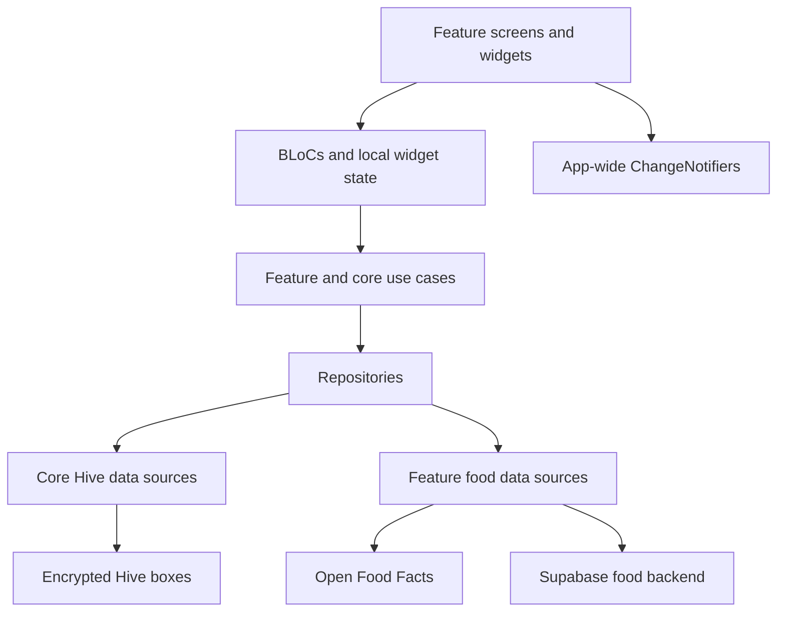
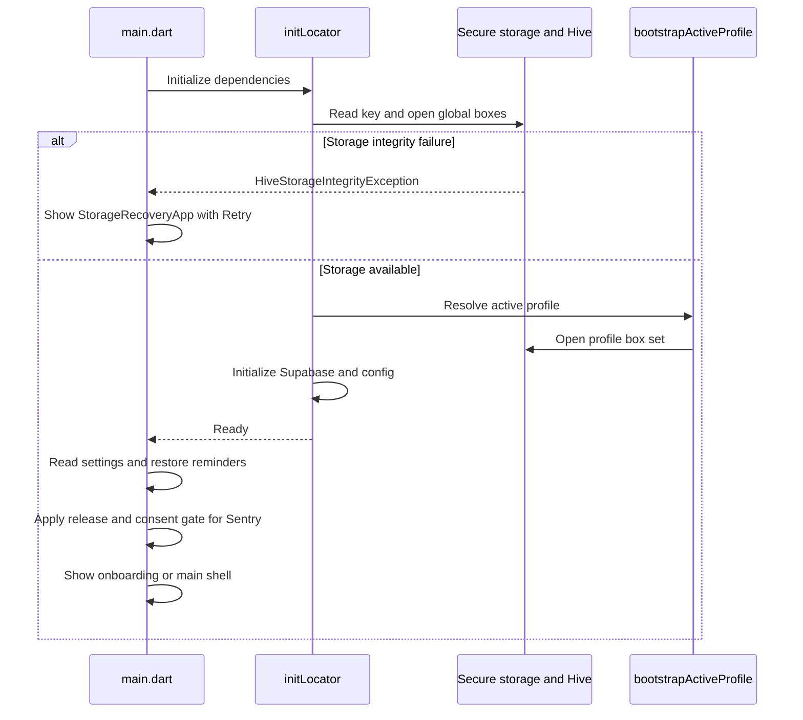
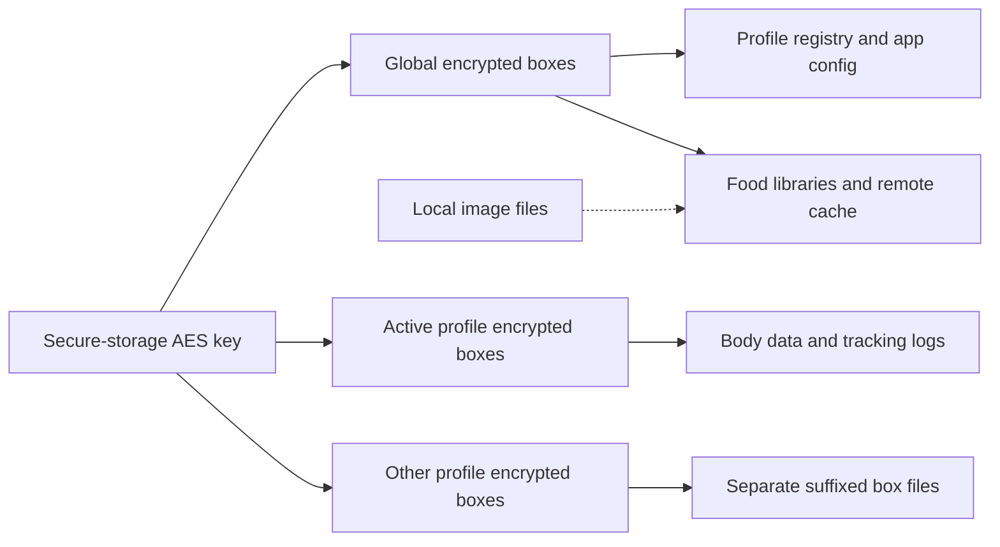
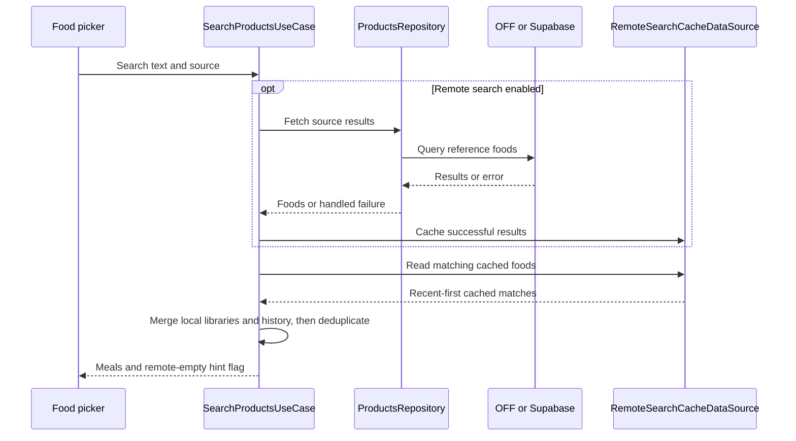

# Architecture

[Documentation index](README.md) · [Contributor conventions](../CONTRIBUTING.md) · [Agent rules](../AGENTS.md)

OpenNutriTracker is a Flutter Android/iOS app. Personal tracking data stays on
the device; remote services supply food reference data. Backend installation,
schema, and ingestion belong to [OpenNutriTracker-Backend](https://github.com/simonoppowa/OpenNutriTracker-Backend).

## Layers and modules

`lib/features/` groups screens and flows. `lib/core/` contains shared models,
repositories, use cases, persistence, calculations, and widgets. Features use
data/domain/presentation layers where needed, not a mandatory directory trio.
DBOs are Hive persistence objects, DTOs represent remote responses, and entities
are domain models. See [AGENTS naming conventions](../AGENTS.md#naming-conventions).

## Startup and recovery

The entry point is [`main.dart`](../lib/main.dart); dependency setup is
[`initLocator`](../lib/core/utils/locator.dart).

1. Initialize Flutter bindings and logging.
2. Read the AES key through `SecureAppStorageProvider`, then initialize Hive
   and global boxes. The key is held by `flutter_secure_storage`.
3. [`bootstrapActiveProfile`](../lib/core/utils/profile_bootstrap.dart) creates a
   default registry entry if necessary, resolves the secure-storage active
   pointer (repairing a stale pointer), and opens the profile's boxes. The first
   profile has an empty suffix to reuse existing single-profile box names.
4. Initialize Supabase, register dependencies, and initialize config defaults
   (including migration of shared app settings from existing profile config).
5. Start an unawaited 90-day remote-cache prune; read profile availability,
   locale, theme, units, and consent. Restore enabled daily reminders.
6. Start Sentry only in release mode with consent; create the Provider tree and
   route to onboarding or the main shell according to `hasUserData()`.

[`HiveStorageIntegrityException`](../lib/core/utils/hive_storage_integrity_exception.dart)
is handled before consent can be read. The recovery screen keeps diagnostics
local and offers a bootstrap retry, not an automatic wipe. Secure-storage key
validation avoids minting a replacement key over existing encrypted Hive files;
encrypted boxes are opened with Hive crash recovery disabled. See
[`StorageRecoveryApp`](../lib/core/presentation/storage_recovery_app.dart).

## Dependency injection, navigation, and state

GetIt registrations live in `locator.dart`. After storage/backend setup, BLoCs
are registered before use cases, repositories, and data sources. Lazy singleton
and factory closures resolve dependencies on demand. Shared page BLoCs such as
Home, Diary, Profile, and Trends persist; factory-created flows such as AddMeal,
Scanner, MealDetail, and Fasting get separate instances.

[`NavigationOptions`](../lib/core/utils/navigation_options.dart) names routes;
`main.dart` registers them. [`MainScreen`](../lib/core/presentation/main_screen.dart)
holds four tabs: **Home / Diary / Trends / You**, with a central add action.
Detail, scanner, recipe, fasting, profile-management, and settings flows use the
navigator stack; some screens are pushed directly rather than by named route.

Feature state generally uses `flutter_bloc` events/states. Provider exposes
ChangeNotifiers for theme, locale, and energy units;
small dialogs/screens also keep widget-local state. Profile switching combines
[`SwitchProfileUsecase`](../lib/core/domain/usecase/switch_profile_usecase.dart)
with [`ProfileSwitchCoordinator`](../lib/features/profile/presentation/utils/profile_switch_coordinator.dart)
to swap boxes, persist the pointer, reload dependent BLoCs, and route as needed.

## Storage boundaries

[`HiveDBProvider`](../lib/core/utils/hive_db_provider.dart) owns the box handles.
All boxes below are AES-256 encrypted. The same installation key serves the
profiles; profile separation is not an account/password boundary.

| Scope | Base box names | Contents |
| --- | --- | --- |
| Global | `ProfileBox`, `AppConfigBox` | Profile registry; theme, locale, units, notification and consent preferences |
| Global | `CustomMealBox`, `RecipeBox`, `CustomActivityTemplateBox` | Shared reusable content libraries |
| Global | `CachedOffMealBox`, `CachedOffMealTimestampsBox` | Both OFF and Supabase meals, with last-touch timestamps |
| Per profile | `UserBox`, `ConfigBox` | Body data and personal nutrition settings |
| Per profile | `IntakeBox`, `UserActivityBox`, `TrackedDayBox` | Logs and day totals |
| Per profile | `WeightLogBox`, `WaterIntakeBox`, `FastingBox` | Weight, water, and fasting history |

Per-profile filenames append `boxSuffix`; the default profile uses unsuffixed
names. Switching closes the old box set. Attached images are separate local
files managed by [`UserImageStorage`](../lib/core/utils/user_image_storage.dart),
not Hive-encrypted image blobs. Deleting all data from Settings clears the active
profile's boxes, leaving global libraries/settings and other profiles intact.

## Food search and cache

[`SearchProductsUseCase`](../lib/features/add_meal/domain/usecase/search_products_usecase.dart)
combines matching custom meals, recipes, custom-food intake history, cached
remote foods, and fresh results, deduplicating in that order. `skipRemote` serves
local-only searches. Remote errors become an empty remote result with a hint,
so local matches remain available. Cache filtering respects the selected source.

- [`OFFDataSource`](../lib/features/add_meal/data/data_sources/off_data_source.dart)
  handles product text search and barcode lookups.
- [`SpFoodDataSource`](../lib/features/add_meal/data/data_sources/sp_food_data_source.dart)
  searches `food_summary` or `food_translation`, with English fallback when the
  localized search is empty. Source selection comes from config. `searchFDCFoodByString`
  calls this Supabase path, not the separately registered direct `FDCDataSource`.
- [`RemoteSearchCacheDataSource`](../lib/core/data/data_source/remote_search_cache_data_source.dart)
  shares the historically OFF-named boxes across both sources. Startup pruning
  removes entries unused for 90 days; selection refreshes touch timestamps.
- [`SearchProductByBarcodeUseCase`](../lib/features/scanner/domain/usecase/search_product_by_barcode_usecase.dart)
  checks custom foods first, then a full cached OFF record, then live OFF.
  Thin text-search cache entries do not substitute for a full barcode lookup.

The [self-hosting guide](supabase-self-hosting.md) describes the app/backend
contract; backend operations remain documented upstream.

## Energy, macros, and days

[`TDEECalc`](../lib/core/utils/calc/tdee_calc.dart) uses the IOM 2005 reference
equations with activity factors. Non-binary profiles default to the mean of the
two references, with optional estrogen-/testosterone-typical reference selection.
[`CalorieGoalCalc`](../lib/core/utils/calc/calorie_goal_calc.dart) adds signed weekly
kg goal ×1100 kcal/day (or fallback ±500/maintenance zero), optional target-weight
tapering, user offset, and logged activity kcal.
[`MacroCalc`](../lib/core/utils/calc/macro_calc.dart) defaults to 60% carbs / 25% fat /
15% protein, converting at 4/9/4 kcal per gram, with configurable overrides.
`MetCalc` computes activity energy from MET, body weight, and duration.

[`DayBoundaryCalc`](../lib/core/utils/calc/day_boundary_calc.dart) maps timestamps
to configurable logical days without rewriting wall-clock timestamps. Calendar
day labels are handled separately from real timestamps. Scientific references
are linked by the in-app Sources & References screen.

## Export and import

Settings' `ExportImportBloc` delegates to `ExportDataUsecase` and
`ImportDataUsecase`. JSON and CSV are separate zip formats; neither is a full
installation backup or live sync. Dataset names, photos, omissions, and CSV
limitations are canonical in [Export bundle format](export-format.md).

## Per-feature code map

Paths below are relative to [`lib/features/`](../lib/features/); shared data and
business logic often live in `lib/core/` rather than inside the feature.

| Feature directory | Entry / key symbols | Responsibility |
| --- | --- | --- |
| `onboarding/` | `onboarding_screen.dart`, `OnboardingBloc` | Seven-page setup and sample-data entry |
| `home/` | `home_page.dart`, `HomeBloc` | Daily summary, logs, water and fasting entry points |
| `diary/` | `diary_page.dart`, `DiaryBloc` | Calendar selection and daily tracking |
| `trends/` | `presentation/`, `TrendsBloc` | Time-window trends and streaks |
| `profile/` | `profile_page.dart`, `ProfileBloc`, `ProfileSwitchCoordinator` | Body/goals, weight history, local profiles |
| `add_meal/` | `presentation/add_meal_screen.dart`, `SearchProductsUseCase` | Search, local libraries, food-source adapters |
| `meal_detail/` | `meal_detail_screen.dart`, `MealDetailBloc` | Food nutrition and portion logging |
| `edit_meal/` | `presentation/edit_meal_screen.dart`, `EditMealBloc` | Logged/custom meal editing |
| `scanner/` | `scanner_screen.dart`, `ScannerBloc` | Barcode camera/manual lookup |
| `add_activity/` | `presentation/add_activity_screen.dart`, `ActivitiesBloc` | Catalog and custom activity logging |
| `activity_detail/` | `activity_detail_screen.dart`, `ActivityDetailBloc` | Duration and activity energy |
| `recipes/` | `presentation/screens/`, `RecipesBloc`, `RecipeBuilderBloc` | Recipe library, ingredients, and sharing |
| `fasting/` | `presentation/fasting_screen.dart`, `FastingBloc` | Warning gate and timer sessions |
| `settings/` | `settings_screen.dart`, `SettingsBloc`, `ExportImportBloc` | App preferences, imports/exports, privacy |

The shared demo engine is in `lib/core/utils/demo/`; `lib/dev/main_dev.dart` is
the separate destructive dev seeder entry point. See [AGENTS demo guidance](../AGENTS.md#demo-data--the-dev-seeder-and-the-shipped-try-it-onboarding-flow)
before using it. Test entry points are in [Testing](testing.md).
